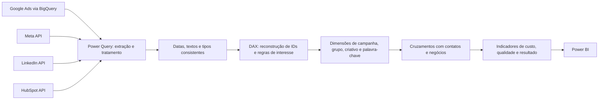

# Growth Analytics — Mídia Paga, Leads e Receita

Case de integração de dados e análise de Growth com **Power BI, BigQuery e APIs de Meta, LinkedIn e HubSpot**.

O desafio foi conectar investimento em mídia à jornada comercial: identificar de qual campanha veio o contato, qualificar a manifestação de interesse e acompanhar oportunidades, propostas e contratos.

## O trabalho por trás do painel

As fontes não entregavam uma chave única e consistente. URLs, UTMs, identificadores de anúncios e propriedades do CRM precisavam de tratamento antes de permitir os cruzamentos.

A solução combinou extração de dados, correções em Power Query, colunas calculadas em DAX e dimensões compartilhadas. O diferencial do projeto está nessa **reconstrução da rastreabilidade entre mídia, contato e negócio**, além da apresentação visual.

## Arquitetura

O desenho resume a arquitetura lógica, sem representar todas as direções de filtro ou afirmar atribuição causal.

## O que foi construído

| Frente | Entrega |
| --- | --- |
| Integração | APIs de mídia e CRM; cinco consultas BigQuery com SQL nativo |
| Qualidade dos dados | Tratamento de datas, textos, valores ausentes e representações numéricas |
| Reconstrução de chaves | Identificação de campanhas, grupos, criativos e palavras-chave em dados do contato |
| Jornada comercial | Regras de manifestação de interesse e cruzamentos com oportunidades e contratos |
| Modelagem | Dimensões compartilhadas e relações de campanha, contato, negócio e tempo |
| Análise | Custos, CPL, CPC, CTR, qualidade dos leads, reconversões e resultados comerciais |

O inventário identificou **7 páginas, 246 medidas DAX e 64 relacionamentos**. Destes, **21 são vínculos com tabelas locais automáticas de datas** e 43 são os demais vínculos. Quantidade de relações não é, por si só, medida de qualidade.

## Evolução relatada no uso do painel

Utilizei as análises para apoiar revisões de campanhas e decisões de investimento, em conjunto com as ações do time.

| Recorte informado | Indicador |
| --- | --- |
| Março de 2023 | CPL de R$ 370,87 |
| Dezembro de 2023 | CPL de R$ 109,26 |
| Janeiro de 2024 | CPL de R$ 67,10 |
| Fechamentos em 2023 | 14 contratos e aproximadamente R$ 33 mil de MRR |
| Fechamentos em 2024 | 10 contratos e aproximadamente R$ 47 mil de MRR |

Os CPLs aparecem nas capturas do meu painel, com os períodos identificados a partir da minha experiência no projeto. Os números anuais de contratos e MRR refletem meu acompanhamento operacional e ainda não foram conciliados com a fonte nesta publicação. O CPL de janeiro não é média anual. A comparação de fechamentos indica maior MRR relatado com menos contratos.

Consulte [contexto e evidências](docs/contexto-resultados.md) para detalhes de ICP, evolução e limites de comparação. Não foi isolado um efeito causal do painel.

## Explore o case

- [O desafio de qualidade, UTMs e correções](docs/qualidade-rastreabilidade.md)
- [Modelagem: por que os relacionamentos foram complexos](docs/modelo-relacionamentos.md)
- [Inventário dos 43 vínculos sem calendários automáticos](docs/inventario-relacionamentos.md)
- [Integrações, paginação e BigQuery](docs/integracoes.md)
- [Colunas calculadas: chaves, plataforma e levantada de mão](docs/colunas-calculadas.md)
- [Indicadores e regras de interpretação](docs/indicadores.md)
- [Unificação: da medida-base ao total de MQL e propostas](docs/unificacao-medidas.md)
- [Código DAX de medidas selecionadas](dax/medidas-selecionadas.dax)
- [Exemplos adaptados de colunas DAX](dax/colunas-demonstrativas.dax)
- [Exemplos Power Query e demonstração local](power-query/README.md)
- [Capturas do painel](assets/screenshots/README.md)

## Contribuição e aprendizado

Este foi um dos projetos mais desafiadores da minha trajetória. Aprendi a utilizar BigQuery, organizei dados históricos, integrei plataformas e reconstruí chaves e regras para reduzir a necessidade de conferência manual pelo marketing.

O painel foi descontinuado em 2025 em função de uma fusão, conforme seu relato. Não foi medido nesta edição o número de horas poupadas ou o ganho de acurácia.

## Escopo da publicação

Portfólio documental com exemplos selecionados e adaptados. O projeto completo, tokens, contas de anúncio, projetos/datasets privados, IDs reais e dados pessoais permanecem reservados.

A leitura foi feita nas definições PBIP e nos materiais fornecidos. Não houve atualização do painel, execução de consultas nas plataformas nem validação dos cálculos no Power BI Desktop. Os exemplos demonstrativos são identificados como adaptações; não representam uma reprodução integral do ambiente histórico.

Veja o [histórico](CHANGELOG.md) e o [escopo público](docs/publicacao.md). Não foi concedida licença de reutilização nesta edição.
