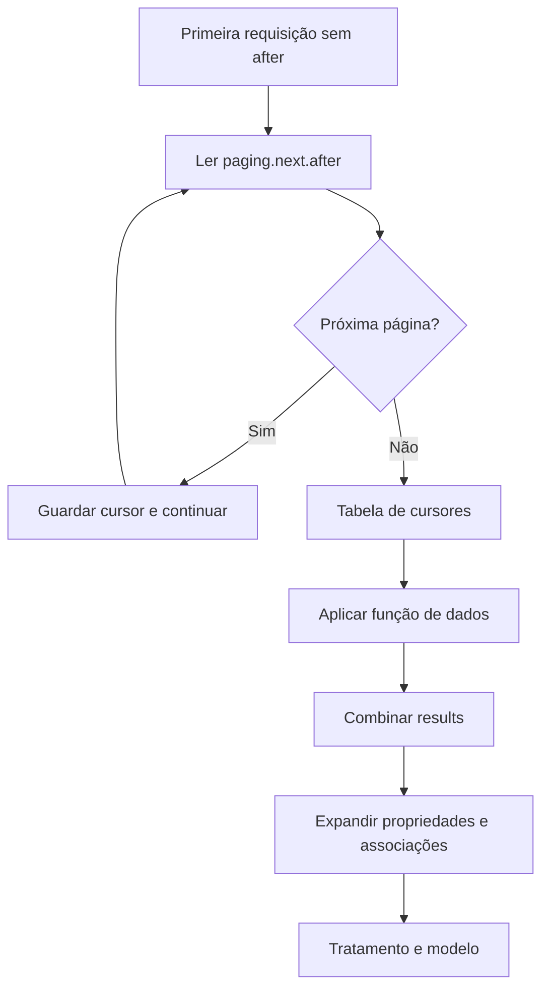

# Integrações e organização da extração

## Frentes confirmadas

| Fonte | Caminho observado no projeto |
| --- | --- |
| Google Ads | Conector GoogleBigQuery e Value.NativeQuery em cinco consultas |
| Meta | Requisições ao domínio graph.facebook.com; métricas por campanha e tabelas de conjuntos/anúncios |
| LinkedIn | Requisições REST de analytics/campanhas/grupos com versão de API parametrizada |
| HubSpot | Contatos, propriedades e requisições CRM v3 com associações de negócios e contatos |

A presença do caminho no arquivo não comprova conectividade atual. Datas de descontinuação e versões precisam ser verificadas antes de uma retomada. Em particular, há referência histórica a uma versão fixa da API Meta; não foi apresentada como versão atual.

## Google Ads via BigQuery

O Power BI lê tabelas no BigQuery por consultas SQL. O processo que alimentava essas tabelas não está demonstrado nos arquivos fornecidos; não foi inventado um job de ingestão, serviço de transferência ou orquestrador.

O [exemplo SQL](../sql/exemplo-campanhas.sql) usa projeto, dataset e campos fictícios. Ilustra seleção e agregação de dados diários, sem copiar identificadores privados nem presumir uma unidade de custo.

Referência do conector: [Google BigQuery no Power Query](https://learn.microsoft.com/en-us/power-query/connectors/googlebigquery).

## HubSpot: duas funções e aplicação

No projeto, fx_Dados_CN obtém dados e expande id, propriedades e associações; fx_Next_Page_CN lê o próximo after. A frente de contatos contém também funções e parâmetros históricos próprios.

O exemplo público de negócios usa:
1. [fxDadosNegocios](../power-query/fxDadosNegocios.pq): requisição e leitura do JSON.
2. [fxProximaPagina](../power-query/fxProximaPagina.pq): consulta o próximo cursor.
3. [Negocios](../power-query/Negocios.pq): gera referências com List.Generate, cria uma tabela de cursores e invoca a função por linha.

O desenho resume o padrão de descobrir cursores e depois obter dados, não uma única passagem de rede. A adaptação usa string vazia para omitir after na primeira chamada e null para terminar; não replica valores iniciais privados nem sinais de parada específicos do original.

O resultado com associações pode gerar múltiplas linhas por negócio ao expandir contatos. A modelagem e as medidas precisam considerar essa multiplicidade.

## Meta e LinkedIn

As funções históricas de mídia recebem recortes e identificadores para solicitar métricas. No trecho de Meta lido, a resposta data é convertida em tabela. No de LinkedIn, elements é retornado pela função de analytics.

Não foi presumido que toda função de mídia implemente paginação completa apenas porque usa API. A existência de limit/count não demonstra que todas as páginas foram percorridas.

Identificadores de contas, listas de propriedades, versões, tokens e consultas integrais permanecem reservados.

## Correção e carga

O [guia de qualidade](qualidade-rastreabilidade.md) explica as transformações observadas. A [demonstração M](../power-query/demo-tratamento.pq) ilustra normalização, cultura de números e sinalização de falhas sem acessar uma fonte externa.

Paginação percorre blocos da API. Dados históricos no BigQuery e loops de extração não comprovam atualização incremental configurada.

## Validação

Não foram feitas chamadas autenticadas, execução de SQL ou atualização no Power BI. Os exemplos ilustram o desenho da solução, e não uma conexão pronta com o ambiente histórico.
