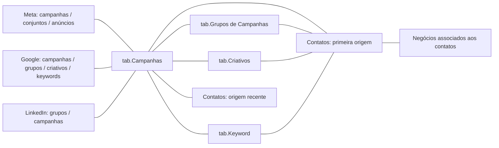

# Modelagem: por que os relacionamentos foram complexos

## O desafio

As fontes tinham granularidades distintas. Dados de mídia descrevem desempenho por campanha, grupo, anúncio, palavra-chave e período; o CRM descreve contatos, versões de origem e negócios. Uma ligação inadequada pode repetir valores de mídia ou atribuir o mesmo resultado comercial a mais de uma origem.

O modelo não deve ser apresentado como uma estrela simples. Ele contém hierarquias, dimensões compartilhadas, múltiplos caminhos e relações ativas/inativas.

## Mapa lógico dos vínculos

As linhas abaixo resumem vínculos entre conjuntos de tabelas, não a direção real de filtros nem a cardinalidade de cada relação.

Nem todo nível de uma plataforma equivale ao nível de mesmo nome em outra. No código, grupos de campanhas do LinkedIn participam da dimensão unificada de campanhas, enquanto campanhas do LinkedIn participam da dimensão de grupos. A documentação preserva essa estrutura sem impor equivalência de produto entre as plataformas.

## Dimensões compartilhadas

| Tabela | Papel observado |
| --- | --- |
| tab.Campanhas | Vínculos com IDs de campanhas das fontes e chaves recuperadas nos contatos |
| tab.Grupos de Campanhas | Liga grupos do Google, campanhas do LinkedIn, conjuntos da Meta e chaves correspondentes nos contatos |
| tab.Criativos | Liga anúncios da Meta, criativos do Google e chaves de criativos nos contatos |
| tab.Keyword | Liga critérios de palavra-chave do Google e chaves nos contatos |
| dCalendario | Referência temporal em dias ou chaves de ano/mês, conforme a fonte |

IDs de plataformas distintas compartilham dimensões. A necessidade de desambiguação e a unicidade dessas chaves devem ser conferidas nos dados; o inventário não prova ausência de colisões.

## Por que as colunas V2 importam

As colunas calculadas reconstroem os IDs utilizáveis nos relacionamentos. Sem chaves coerentes entre CRM e mídia, o filtro de campanha não alcançaria os contatos conforme a análise pretendida.

A cadeia técnica é: evidência de URL → regra de identificação → ID recuperado → dimensão → contato/negócio → indicador. O resultado do gráfico depende de todas essas etapas.

## Primeira e última origem

hs_Contados_First e hs_Contatos_Last possuem papéis diferentes e vínculos próprios com campanhas e datas. Isso permite construir leituras de origem inicial e recente, mas não comprova um modelo multitoque com pesos ou uma regra única de atribuição.

A medida de reconversão usa uma classificação na tabela de origem recente. A elegibilidade e possíveis sobreposições precisam de validação.

## Relações ativas, inativas e filtros

O arquivo contém 64 relações, das quais 21 envolvem tabelas locais automáticas de datas. Há 30 inativas e 16 que declaram bidirecionalidade, considerando o conjunto completo.

Nas medidas unificadas de perdas e TCV, USERELATIONSHIP escolhe vínculos entre a chave de campanha da plataforma e a dimensão correspondente. Relações inativas não são necessariamente erros: podem representar caminhos alternativos utilizados por medidas.

Filtros bidirecionais podem alcançar tabelas por outros caminhos. É necessário considerar interação entre calendário, dimensões e contatos antes de interpretar os totais.

O [inventário](inventario-relacionamentos.md) informa os estados e a configuração de filtro dos 43 vínculos sem as tabelas automáticas de datas.

## Temporalidade heterogênea

Há relações diárias e relações por chave ano/mês. Comparar tabelas com granularidades diferentes exige coerência do período e das regras de agregação. Um visual mensal não torna as fontes automaticamente equivalentes.

## Contato e negócio

O vínculo contact.id → vid relaciona negócios expandidos aos contatos de primeira origem. Se um negócio possuir múltiplos contatos, a expansão pode multiplicar linhas. DISTINCTCOUNT ou iteração por IDs distintos pode ajudar em medidas específicas, mas não valida sozinho toda a atribuição.

No projeto foram encontradas medidas comerciais com DISTINCTCOUNT do negócio e SUMX sobre VALUES do ID. Essas escolhas são relevantes para compreender a intenção de agregação.

## Como apresentar a complexidade

O número de linhas no modelo não é o argumento central. O trabalho está em conciliar níveis de mídia, recuperar chaves, definir papéis temporais e sustentar leituras do investimento ao negócio com regras explícitas.

A captura do modelo fornecida pelo autor foi usada como referência visual. Diagramas simplificados tornam a explicação legível; o PBIP completo continua reservado.
