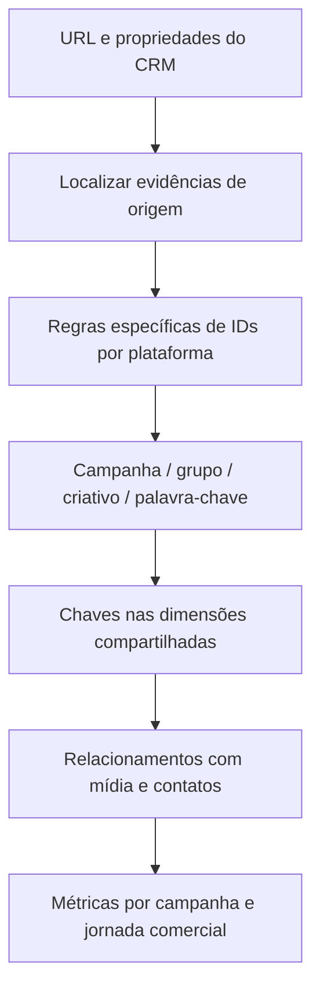

# Qualidade de dados e reconstrução da rastreabilidade

## O problema de integração

O trabalho não consistiu apenas em conectar quatro fontes. Era necessário conciliar representações diferentes da mesma origem comercial:

- Nome de campanha nem sempre equivalia a uma chave utilizável.
- URLs e propriedades do CRM guardavam informações de rastreamento em campos distintos.
- O primeiro contato, a origem mais recente e a primeira página de WhatsApp podiam apontar para evidências diferentes.
- Uma campanha, um grupo, um criativo e uma palavra-chave pertencem a níveis distintos.
- Datas e valores chegavam em representações que exigiam conversão.

Antes dessa estrutura, o marketing precisava verificar manualmente se manifestações de interesse haviam se desdobrado em contratos. No painel, organizei regras e vínculos para apoiar essa leitura.

## UTM, URL e ID são coisas diferentes

UTMs são parâmetros de rastreamento em links, como utm_source, utm_medium e utm_campaign. Um identificador de anúncio/campanha também pode aparecer em uma URL, sem ser necessariamente uma UTM.

Nos exemplos históricos, várias colunas V2 usam CONTAINSSTRING para localizar identificadores conhecidos na URL de primeira origem e/ou na página de WhatsApp. Portanto, o trabalho inclui tanto leitura de parâmetros quanto **recuperação por correspondência de padrões conhecidos**. Não se trata de um parser universal de UTMs.

## Duas camadas de tratamento

| Camada | Papel observado |
| --- | --- |
| Power Query / M | Extração, expansão do JSON, conversões e padronização antes do carregamento |
| Colunas calculadas DAX | Construção de chaves e classificações por linha no modelo |
| Medidas DAX | Agregações e indicadores no contexto de filtros dos visuais |

Uma coluna calculada não é uma medida. A separação explica por que parte do trabalho técnico não aparece diretamente nos gráficos.

## Correções observadas em negócios e contatos

Na consulta de negócios/contatos foram identificadas remoção da parte horária de createdate por delimitador, adaptação de separador decimal, preenchimento de origem/porte ausentes, normalização textual da origem e conversão de datas e números.

Também há expansão de associações de contatos nos negócios. Essa expansão pode gerar mais de uma linha para um negócio associado a vários contatos; isso exige atenção nas contagens, nos valores e na atribuição.

A presença das etapas comprova que o tratamento existe, mas não comprova que todo valor convertido esteja correto ou que todas as inconsistências tenham sido resolvidas.

## Recuperação de chaves

A lista integral de correspondências fica reservada. Os exemplos públicos usam marcadores distintos e um número reduzido de regras.

## Levantada de mão e assinatura

A classificação de manifestação de interesse combina datas de conversão, origem e formulário, tipos de origem e regras de exceção. Há ainda um caminho alternativo quando existe página de WhatsApp sem URL de primeira origem.

Essa classificação **não comprova assinatura**. O desdobramento comercial precisa de associação entre contato e negócio, data de assinatura e filtros de elegibilidade. A coluna histórica de assinatura seleciona uma data máxima, não necessariamente a primeira assinatura.

Na expressão de assinatura lida no projeto, a construção DATE usa os componentes em ordem diferente de ano, mês e dia. Isso exige revisão antes de reutilização. O exemplo público adapta essa ordem para a forma documentada e não altera o original. Referência: [DATE no DAX](https://learn.microsoft.com/en-us/dax/date-function-dax).

## Limites e possibilidades de evolução

- Correspondências por substring e listas fixas exigem manutenção e podem produzir ambiguidade.
- A primeira regra verdadeira de SWITCH determina o resultado; a ordem expressa prioridade.
- Mais de uma plataforma pode ter evidência no mesmo contato.
- Associar um contato a um negócio não comprova que uma campanha causou a venda.
- Converter datas removendo horário perde informação e não resolve automaticamente fuso.
- Trocar ponto por vírgula não é uma estratégia universal de conversão numérica.

Os exemplos M usam cultura explícita e sinalizam falhas de conversão. Isso é uma adaptação didática; não se afirma que esse mecanismo de validação já existia no projeto histórico.

## Valor técnico demonstrado

O case evidencia a capacidade de investigar divergências entre fontes, criar uma camada de tratamento, definir chaves de relacionamento e transformar regras operacionais em análises repetíveis. Não se publica um percentual de acurácia ou economia de horas sem medição.
