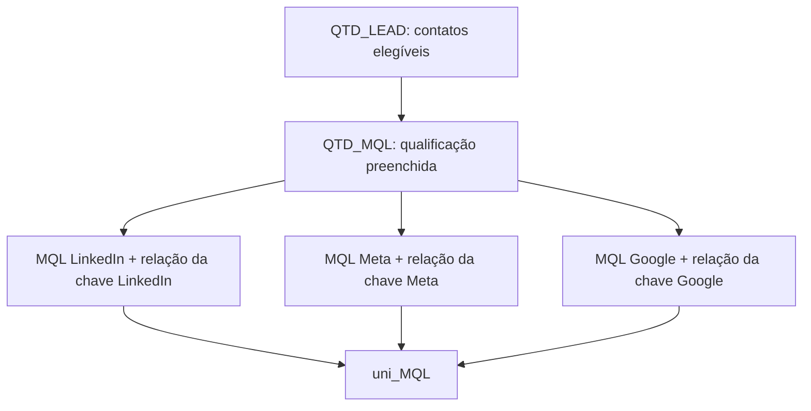
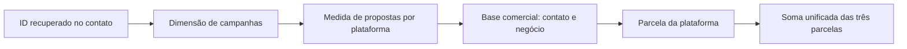

# Da regra de negócio ao indicador unificado

## A dificuldade não estava apenas na soma final

Para apresentar um único total de MQL ou propostas ao marketing, foi necessário estabelecer um caminho entre evidências de campanha no contato, dimensões compartilhadas e regras comerciais.

A soma final é a camada mais visível. Ela depende das correções de IDs, dos relacionamentos e da elegibilidade implementada nas medidas-base.

| Camada | Responsabilidade |
| --- | --- |
| Dados e chaves | Recuperar o ID adequado a partir dos campos de origem |
| Relacionamentos | Definir os vínculos existentes entre campanha, contato, calendário e negócio |
| Medida-base | Aplicar a definição de lead, MQL ou proposta |
| Medida por plataforma | Avaliar a base pelo vínculo de campanha de Meta, Google ou LinkedIn |
| Medida unificada | Somar as parcelas das três plataformas para os cartões e análises |

O código das duas cadeias está em [cadeias-unificacao.dax](../dax/cadeias-unificacao.dax), com 11 expressões selecionadas. Duas já aparecem no arquivo de medidas unificadas; não são indicadores adicionais independentes.

## Exemplo 1: a cadeia de MQL



### Base de elegibilidade

QTD_LEAD conta contatos distintos, exige a classificação histórica de validação igual a Não e levantada de mão igual a Sim. Também utiliza a relação entre calendário e data de envio do formulário. O significado integral da classificação histórica de validação depende das regras reservadas do projeto.

QTD_MQL acrescenta a existência da data de qualificação:

```dax
QTD_MQL =
CALCULATE(
    [QTD_LEAD],
    hs_Contados_First[Data que virou MQL]<>BLANK(),
    USERELATIONSHIP(dCalendario[Date],hs_Contados_First[Data de Envio de Formulário]))+0
```

Ter uma data de MQL preenchida é um critério de elegibilidade. A data utilizada no relacionamento com o calendário continua sendo **envio do formulário**, e não a data em que o contato virou MQL.

### Especialização por plataforma

```dax
ad.GrupoC_Linkedin_MQL =
CALCULATE([QTD_MQL],
    hs_Contados_First[ID Linkedin Grupos de Campanha_V2]<>BLANK(),
    USERELATIONSHIP(hs_Contados_First[ID Linkedin Grupos de Campanha_V2],'tab.Campanhas'[id]))+0
```

A medida:
1. Parte da mesma base QTD_MQL.
2. Exige uma chave LinkedIn preenchida no contato.
3. Usa o vínculo entre essa chave e tab.Campanhas[id] no cálculo.

O projeto implementa o mesmo padrão para Meta e Google, utilizando suas próprias colunas de chave. Isso evita tratar os três IDs de campanha do contato como se fossem uma única coluna.

### Consolidação

```dax
uni_MQL =
[ad.GrupoC_Linkedin_MQL]+[cp.Meta.Campanhas_MQL]+[cp.Google_Campanhas_Google.MQL]
```

Cada parcela é avaliada com suas regras de plataforma. A medida unificada consolida essas parcelas; não altera permanentemente os relacionamentos do modelo.

## Exemplo 2: a cadeia de propostas

A medida-base Proposta Apresentada conta negócios distintos, filtra um pipeline e exige etapas/datas de qualificação, agendamento e proposta nos contatos, além de levantada de mão. Ela utiliza as relações de criação do negócio com o calendário e de contact.id com vid.

Essa base não é simplesmente a contagem de uma coluna de propostas da plataforma de anúncios: o resultado depende da jornada registrada no CRM.

```dax
cp.Meta.Campanhas_Propostas =
CALCULATE([Proposta Apresentada],
    hs_Contados_First[ID Facebook Campanha_V2]<>BLANK(),
    USERELATIONSHIP(hs_Contados_First[ID Facebook Campanha_V2],'tab.Campanhas'[id]))+0
```

O vínculo de campanha delimita os contatos que participam do cálculo. A medida-base usa as relações e os filtros necessários para avaliar os negócios associados.

```dax
uni_Proposta =
[cp.Meta.Campanhas_Propostas]+[cp.Google_Campanhas_Propostas]+[ad.GrupoC_Linkedin_Propostas]
```



O desenho representa dependências lógicas. Não é um mapa da direção de propagação de cada relacionamento.

## Exemplos concretos: qual ID se relaciona com qual ID?

Os pares abaixo foram conferidos no arquivo de relacionamentos. Todos estão registrados como **inativos** no projeto, e as medidas selecionadas utilizam USERELATIONSHIP para os respectivos papéis.

| Campo da tabela | Campo relacionado | Exemplo de uso |
| --- | --- | --- |
| hs_Contados_First[ID Facebook Campanha_V2] | tab.Campanhas[id] | MQL e propostas atribuídos à parcela Meta |
| hs_Contados_First[ID Google Campanha_V2] | tab.Campanhas[id] | MQL e propostas atribuídos à parcela Google |
| hs_Contados_First[ID Linkedin Grupos de Campanha_V2] | tab.Campanhas[id] | MQL e propostas atribuídos à parcela LinkedIn |
| hs_Negócios_Contatos[contact.id] | hs_Contados_First[vid] | Avaliação dos negócios associados ao contato |
| Meta_Campanha_Dados[campaign_id] | tab.Campanhas[id] | Vínculo da fonte de mídia com a dimensão; sua ativação depende da medida analisada |

No LinkedIn, a dimensão usa a chave de **grupo de campanhas**, conforme a hierarquia do projeto. O nome da medida não deve esconder essa diferença de granularidade.

### Correspondência fictícia de valor

| Local | Campo | Valor fictício |
| --- | --- | --- |
| Contato do CRM | ID Facebook Campanha_V2 | camp_meta_a |
| Dimensão de campanhas | id | camp_meta_a |
| Fonte Meta | campaign_id | camp_meta_a |

A igualdade da chave permite relacionar as linhas, com tipos compatíveis e dados íntegros. O valor fictício ilustra a correspondência; não é um ID real.

Ter os três valores iguais não significa que todos os caminhos estejam ativos ao mesmo tempo. A medida determina quais relações existentes participam daquela avaliação.

## O papel de USERELATIONSHIP

USERELATIONSHIP utiliza um relacionamento já definido durante a avaliação do cálculo. Ele não cria chaves, não corrige URLs e não materializa uma junção nova.

Por isso, o trabalho de qualidade e modelagem era pré-requisito para a unificação: sem chaves consistentes e vínculos definidos, a soma não representaria a análise pretendida.

## Pontos de interpretação

- A mesma base torna a regra entre plataformas mais consistente, mas não comprova comparabilidade de todas as fontes.
- Um contato ou negócio pode aparecer em mais de uma parcela. A soma não faz deduplicação global automática.
- DISTINCTCOUNT na base comercial evita certas duplicações no contexto daquela parcela, mas não garante exclusividade entre parcelas.
- Uma chave preenchida não comprova atribuição causal à campanha.
- Filtros por calendário e papéis de data precisam ser considerados junto dos vínculos de campanha.

## Escopo

As expressões foram conferidas no projeto. O pipeline foi substituído por marcador; o código integral de preparação e as listas de chaves permanecem reservados. A documentação explica as dependências, mas não substitui a validação no Power BI Desktop.
